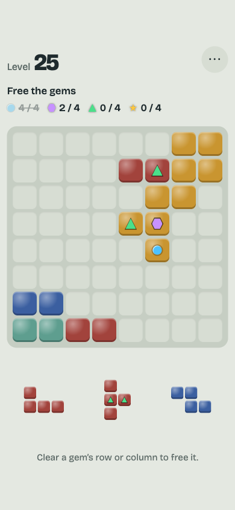
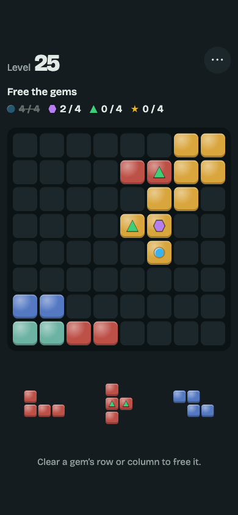

# Kiln

An ad-free 8x8 block puzzle for phones. Drag pieces onto the board; full rows and
columns clear. Levels are generated endlessly, and every tray of pieces you get can be
placed, so a loss is never down to bad luck.

**Play:** https://thomaslazar.github.io/kiln/

<p>
  
  
</p>

## Install on your phone

Kiln is a progressive web app and works offline once loaded.

- **iPhone (Safari):** tap Share, then “Add to Home Screen”.
- **Android (Chrome):** open the menu, then “Add to Home screen” or “Install app”.

## Levels

- **Score:** reach a target score. Multi-line clears, combos and board clears pay extra.
- **Gem goals:** free gems of up to five colours, each with its own count.
- **Gem rush:** free lots of gems of one colour; every piece carries them.

Stuck? Use a continue to get three rescue pieces and keep going. You earn them every
5 levels and on long combos, and a level you keep failing offers one for free. Fail a
level four times and the retry gets easier targets. No ads, no accounts, no
tracking. Progress is saved in your browser.

## Languages

English and German. The game follows your phone’s language and can be switched in the
menu. Want Kiln in your language? Translating is one JSON file, no coding needed:
see [Add a language](CONTRIBUTING.md#add-or-improve-a-language).

## Run locally

No build step and no dependencies. Serve the folder with any static server:

```
python3 -m http.server
```

Then open http://localhost:8000. Opening `index.html` directly from disk does not work,
because browsers block ES modules on `file://`.

- `node --test` runs the unit tests.
- `node tools/sim.mjs` runs the balance bot over all level types.

## Docs

- [Game design](docs/game-design.md): goals and rules.
- [Contributing](CONTRIBUTING.md): conventions for code, copy and commits.

Pushes to `master` are tested and deployed to GitHub Pages by
[a workflow](.github/workflows/pages.yml).

## License

[PolyForm Noncommercial 1.0.0](LICENSE.md). Free to play, study, modify and share for any
noncommercial purpose. Commercial use is not permitted without the author’s permission.

The bundled font, Bricolage Grotesque, is under the [SIL Open Font License 1.1](fonts/OFL.txt).
